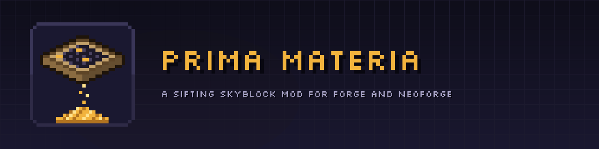

**Prima Materia** is a skyblock resource mod. You start on a small island in the void with one tree, and every resource in the game comes from breaking matter down and sorting it: crush it with a hammer, shake it through a sieve, soak it in a barrel and melt it in a crucible.

## Features

- **The sieve** is the star: five mesh tiers (cloth, copper, iron, diamond, netherite), an animated mesh that shakes while material thins out, finds that fall through, and a sound for every step. Sieves hold a stack of material and show their progress on the block itself.
- **Hammers** that break blocks down, from gravel and sand to finer dust, in tiers from wood to netherite.
- **Barrels** for composting, mixing fluids and slow transformations.
- **A crucible** that melts stone and dust into molten metal, and casting trays that turn it into ingots.
- **The Nether and the End** are part of the chain, with soul sand sifting for mob drops.
- **The Auto Hammer and the Powered Drive** run the same work without you standing there.
- **No screens and no text to read.** Every block is used in the world and reads its state from its model.
- **Everything is data.** Every recipe and every sifting table is a datapack file, so packs can add, change and remove any of it.

## Compatibility

- Recipe viewers: BEI, JEI and REI show every recipe family and the sifting tables where builds exist for the Minecraft version.
- Scripting: an optional ModJS global, `PrimaMateria`, and datapack JSON for KubeJS and datapacks.
- Works with SMWTI and Jade for the state of blocks in the world.
- Minecraft 26.2 and 26.3 on Forge and NeoForge, one jar per Minecraft version.

## Links

- Source: https://github.com/ItMeCasey/PrimaMateria (MIT)
- Wiki: https://itmecasey.com/wiki/primamateria/
